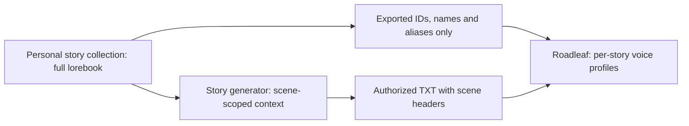

# Personal collection and future generator contract

The full NovelAI lorebook/module stays in the owner's **Personal Story Collection**, outside this reader repository. It is not an app asset, default module, executable plugin or global narration setting. Collection packages are not automatically uploaded. The generic tools in `scripts/` operate on owner-selected local files; their source contains no personal lore text.

## Lorebooks and cast files on the phone

**Voice → Characters → Import cast or lorebook** also reads a lorebook file directly on the phone: a NovelAI `.lorebook` (or the lorebook inside a scenario or story file), lorebook JSON in the common `entries` form, or a character card. Each entry is read only to recognise characters. Roadleaf keeps their names, nicknames and a pronoun hint; the entry text, context settings and phrase-bias groups are never stored, and the file itself is not kept. The full lorebook still lives only where you keep it.

Imported characters then get installed voices from the selected speech app: female and male voices where the app labels them, otherwise distinct voices to check with **Hear**. **Export cast** writes a `roadleaf-voice-cast` file (version 1) with the book's cast settings, characters and learned voices, and no story text, for import into any book.

`collection-manifest.json` uses `format: personal-story-collection`, version 1, a stable `profileSetId`, optional `storyId`, relative module/NovelAI/metadata filenames, and explicit reader/generator boundaries. The current package leaves the story ID and generator connection unset. This is an integration contract and working local file workflow; no remote generator endpoint is implemented or connected.

The reader sidecar uses `format: roadleaf-scene-profiles`, version 1, `profileSetId`, and `entries`. The [export schema](roadleaf-scene-profiles-v1.schema.json) defines the portable metadata contract. Each character entry contains an ID, display name, literal name/alias keys, category and enabled flag. It contains **no** lore text, context configuration or phrase-bias groups. Roadleaf rejects a full NovelAI lorebook and rejects those module fields even if a file claims the sidecar format. The reader accepts a maximum of 64 character profiles, 512 metadata entries and a 2 MB file. Names/aliases and IDs have additional short bounds. No regex from an imported file is executed.

Roadleaf persists only this selected story's profile-set/character IDs, names, aliases and local voice/delivery choices. Matching character IDs preserve manual voices when display names change. Import cannot silently replace a different existing profile-set link. The owner can unlink in the cast editor while retaining voice choices, then save. Existing books with no collection link retain their prior behavior. No package or module auto-loads at startup.

The future generator must preserve story and profile-set identities across revisions, keep full context in the personal collection, and emit an authorized UTF-8 TXT plus this metadata sidecar. Prefer `[Scene: Name, Other Name]` headers for precise scene membership. The same headers drive NovelAI's explicit-cast lorebook and Roadleaf's voice gate. The reader does not speak the headers. Without a header, its optional automatic scene gate uses literal names/aliases; it does not infer physical presence or exclude all offstage mentions semantically.

Import the initial TXT as a book. Later revisions use **Update story text (TXT)** on that existing book, never an implicit title match. Progress relocates an exact paragraph where possible; changed/ambiguous anchors produce a visible fallback to the updated chapter beginning. Normal Play stays precise; Resume paragraph replays the saved paragraph from its start. A future API adapter must apply the same explicit targeting, revision/anchor safeguards and no-autoplay rules. Chapter-specific narrator links migrate only where a chapter match is clear; review them after major chapter restructuring.

`Export-ReaderProfiles.ps1` exports metadata from a local collection module. `Prepare-SceneLorebook.ps1` produces a separate NovelAI-compatible copy and preserves all entry texts/IDs, including the original global campaign entries. It does not train or install an AI model. NovelAI regex activation has a bounded recent search window (up to 10,000 characters); long scenes need repeated cast headers. Live import/activation remains a NovelAI account test, not something guaranteed by local regex checks.

## Existing-browser reading in 0.3.15

The optional NovelAI browser reader captures only the selected rich story editor from existing Chrome or an explicitly launched, verified installed NovelAI WebAPK. It stores authorized story prose as a separate per-story library book and follows append-only completed paragraphs. This adds a local browser-to-reader text path; it does not load the full collection module or modify NovelAI context. IDs/names/aliases remain an explicit per-book metadata import. A future generator adapter must keep the same source identity, revision, paragraph-progress and no-unprompted-autoplay safeguards. TXT export/update remains an alternative file path; it is no longer required for live NovelAI reading. See [CHANGELOG.md](../CHANGELOG.md) for versions.
Optional voice metadata can specify an installed `enginePackage`, `mainCharacter` aliases, `mainVoice`, `mainPronoun`, `narratorVoice`, and per-entry `voice`, `pronoun`, `delivery`. These are bounded local voice IDs and enums, never lore or generation prompts. Voices a file names but the phone lacks are replaced with installed ones, and the import summary says so. Existing manual choices retain priority. Such presets remain in the owner's collection and are imported only into the explicitly selected book.